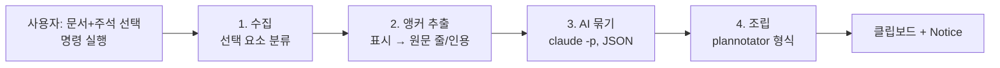

# 캔버스 주석 → 앵커드 피드백 내보내기 (설계)

작성일: 2026-11-05 · 대상 레포: `~/Codes/obsidian-excalidraw-plugin` (포크)

## 1. 왜 만드나

사용자는 AI 답변을 md 파일(주로 `Whiteboard/Excalidraw Cards/*.md`)로 만들어 Excalidraw 화이트보드에 **embeddable**로 붙인 뒤, 캔버스 위에서 읽으며 빨간 펜으로 밑줄을 긋고 스티키 노트로 코멘트를 단다. 그런데 AI에게 피드백을 보내는 통로가 plannotator라서 캔버스에 남긴 표시를 plannotator에서 **다시 하나씩 옮겨야** 한다. 같은 리뷰를 두 번 하는 셈이다.

plannotator가 하던 핵심 역할은 하나다. **"어느 파일의 몇 번째 줄, 어떤 문장에 어떤 코멘트가 달렸는지"를 agent가 정확히 이해할 수 있는 형태로 만드는 것.** 이 역할만 지켜지면 plannotator를 거칠 필요는 없다(사용자 확인).

## 2. 목표 / 비목표 / 안티골

**목표**
- 캔버스에서 선택한 문서와 그 위의 주석을 명령 하나로 plannotator의 "Markdown Annotations" 형식 텍스트로 바꿔 클립보드에 복사한다.
- 인용문과 줄 번호가 원본 md와 정확히 일치한다.
- "이 코멘트가 어느 문장에 대한 것인가"는 AI가 맥락을 보고 판단한다. 사용자는 묶음 규칙을 따로 지키지 않는다.

**비목표**
- plannotator 앱/서버 연동, plannotator UI 재현
- AI 세션으로 자동 전송. **클립보드 복사까지만** 한다(사용자 결정).
- 보드 전체 또는 여러 리뷰 회차의 자동 구분. 범위는 사용자의 **선택**으로 정한다.
- 내보낸 뒤 캔버스 주석을 "처리됨"으로 표시하는 등의 상태 관리

**안티골 (돌아가더라도 실패로 보는 경우)**
- 인용문이 원문과 다르다. AI가 바꿔 썼거나, 화면 텍스트를 잘못 읽은 경우
- 줄 번호가 틀려서 agent가 엉뚱한 곳을 고친다.
- 코멘트가 누락되거나, 엉뚱한 문장에 붙는다.

## 3. 출력 형식 (계약)

사용자가 제공한 plannotator 출력 예시와 같은 구조를 쓴다.

```markdown
# Markdown Annotations

File: <md 파일 절대 경로>

I've reviewed this document and have N pieces of feedback:

### 1. General feedback about the document
> <코멘트>

### 2. (line 103) Feedback on: "<인용문>"
> <코멘트>

### 3. (lines 107–125) Feedback on: "<인용문>"
> <코멘트>

---

Please address the annotation feedback above.
```

- 선택에 문서가 여러 개 섞여 있으면 plannotator의 폴더 형식을 쓴다. 사용자 예시 기준:
  ```markdown
  # Markdown Annotations

  # Folder Document Feedback

  The following feedback is on files in the reviewed folder, grouped by file.

  ## <파일 A 절대 경로>

  I've reviewed this document and have N pieces of feedback:   ← N은 파일별 개수

  ### 1. ...                                                     ← 번호는 파일마다 1부터
  ```
  끝에는 `---`와 `Please address the annotation feedback above.`가 한 번만 온다. 문서가 하나면 위의 단일 파일 형식을 쓴다(빌더 판단: 단일 파일일 때 폴더 헤더 생략).
- 줄 번호는 md 원본 파일 기준이며 1부터 센다. frontmatter도 줄 수에 포함한다.
- 인용문은 표시 아래에 실제로 있는 원문 부분 문자열이다. 줄 범위만 찾을 수 있고 정확한 부분 문자열을 못 찾은 경우에는 그 줄들의 원문 전체를 쓴다.

## 4. 실제 사용 패턴 (관찰한 사실)

`Whiteboard/KOS Talk 일회성 대량 발송 설계.excalidraw.md`를 열어 확인한 내용이다.

- 문서: `embeddable` 요소, `link: "[[Whiteboard/Excalidraw Cards/....md]]"`. 문서 전체가 펼쳐지도록 높이를 크게 둔다(800×2880, 1314×21514). 내부 스크롤은 없다고 봐도 된다.
- **표시(anchor)**는 모두 빨간색(`#e03131`)이다.
  - `line`(height 0): 밑줄. 여러 줄에 걸친 문장은 연속된 밑줄 여러 개로 긋는다.
  - `rectangle`(배경 투명): 문장이나 구절을 감싸는 박스
  - 세로 `line`(width 0): 문서 옆에 그은 구간 표시(여러 줄 범위)
- **코멘트**
  - `stickynote`(포크의 커스텀 타입, 노란 배경) + 안에 담긴 `text`(`containerId`)
  - 문서 밖에 놓인 자유 `text`(예: 빨간 "아주 중요해")
- **연결 방식:** 주로 "근처에 둠", 가끔 화살표(사용자 응답). 관찰한 보드에는 화살표가 없었다. 스티키 하나가 밑줄 두 개 사이에 놓이는 등 위치만으로는 애매한 경우가 실제로 있다.

## 5. 결정 사항

| 항목 | 결정 | 출처 |
|---|---|---|
| 범위 | 사용자가 선택한 요소만 (문서 embeddable + 표시 + 코멘트) | 사용자 |
| 코멘트 없는 밑줄 | 출력에서 뺀다 | 사용자 |
| 결과 전달 | 클립보드 복사 | 사용자 |
| plannotator 경유 | 하지 않는다. 형식만 맞춘다 | 사용자 |
| 묶음 판단 | AI(로컬 `claude -p`)가 한다 | 설계자 판단 |
| 정확성 경계 | 인용문·줄 번호는 결정적 추출 단계가 만들고, AI는 **ID로만** 참조한다 | 설계자 판단 |

## 6. 구조



### 6.1 수집
선택된 요소를 세 가지로 분류한다.
- 문서: `embeddable` 중 link가 vault의 `.md`인 것
- 표시: 문서의 bbox와 겹치는 `line`, `rectangle`. `freedraw`는 1차 범위에서 제외한다(관찰된 사용 없음, 설계자 판단). 펜 획을 해석하려면 밑줄/동그라미/취소선 분류기가 따로 필요하다.
- 링크는 파일 전체(`[[file.md]]`)만 지원한다. `#heading`/`#^block` 서브패스 embeddable은 건너뛰고 Notice로 알린다(관찰된 사용 없음, 설계자 판단).
- 코멘트: `stickynote` 컨테이너의 텍스트, 컨테이너가 없는 `text`, 그리고 화살표 바인딩 정보

**표시와 코멘트를 무엇으로 구분할지는 빌더가 정한다.** 관찰상으로는 "문서 bbox와 겹치는 선/박스 = 표시, 텍스트를 담은 것 = 코멘트"로 충분하다. 색으로 거르는 건 취약하니 피한다.

### 6.2 앵커 추출 (결정적, 이 기능의 핵심)
각 표시마다 원본 md 기준의 `{file, lineStart, lineEnd, quote}`를 만든다.

- md embeddable은 같은 DOM 안의 Obsidian `WorkspaceLeaf`로 렌더링된다(`src/view/components/CustomEmbeddable.tsx`의 `RenderObsidianView`, 기본은 reading mode). 따라서 scene 좌표를 화면 좌표로 바꾸면 그 지점의 DOM을 조사할 수 있다.
- 탐침 지점
  - 밑줄: 선 바로 **위쪽**(글자 줄 높이의 절반 정도 위)을 x 구간을 따라 샘플링한다. 밑줄은 글자 아래에 그어지기 때문이다.
  - 박스: 박스 내부
  - 세로선: y 구간 전체 → 줄 범위만 얻는다(인용은 그 범위의 원문)
- 줄 번호를 구하는 방법은 빌더가 고른다. 후보는 다음과 같다.
  - (a) reading mode: 탐침 지점의 텍스트(`caretRangeFromPoint` 등)를 얻은 뒤 원본 md에서 문자열로 찾아 줄을 계산한다. 같은 문자열이 여러 번 나오면 Obsidian preview renderer의 section 줄 정보(비공개 API)나 위치 순서로 구분한다.
  - (b) live preview/source 모드로 잠시 바꾼 뒤 CM6 `posAtCoords` / `lineBlockAtHeight`로 원본 오프셋을 바로 얻는다.
- **알려진 위험**
  - 화면 밖 embeddable은 마운트되지 않는다. 또 Obsidian의 reading view와 CM6는 보이는 부분만 렌더링한다(가상화). 21514px짜리 문서에서는 표시 아래 DOM이 아직 없을 수 있다. **사용자 결정: 내보내기 중에 캔버스가 표시 위치로 스크롤/줌해도 된다.** 그러니 표시마다 해당 영역을 화면에 띄워 렌더링을 보장한 뒤 읽고, 끝나면 원래 뷰(scroll·zoom)로 되돌린다. 높이 모델 기반 계산은 쓰지 않는다. 문서 내부 가상화가 이 방식으로 실제 풀리는지는 빌더가 스파이크로 먼저 확인한다.
  - 문서 변경 드리프트: 표시를 그린 뒤 md가 바뀌어 표시가 다른 문장 위에 놓이는 경우는 **처리하지 않는다(사용자 결정).** 내보낼 때의 현재 렌더링을 기준으로 읽는다.
  - 표, 리스트, 코드블록처럼 렌더링 결과와 원문이 다른 블록. 예를 들어 사용자 예시의 `(lines 107–125)`는 표 하나 전체다. 표 안의 셀을 짚은 경우에는 표 전체 줄 범위 + 셀 텍스트 인용이면 충분하다(plannotator도 그렇게 낸다).
- 추출에 실패한 표시는 버리지 않는다. `quote: null`과 대략적인 위치를 담아 AI에게 넘기고, 출력에는 "위치 불확실"로 표시하거나 경고 Notice를 띄운다(어느 쪽인지는 빌더 판단).

### 6.3 AI 묶기
- 입력(JSON): 앵커 목록 `{id, file, lines, quote, bbox}`, 코멘트 목록 `{id, text, bbox, arrowTo?}`, 문서별 bbox
- 출력(JSON): `[{commentId, anchorIds: [...]} | {commentId, general: true}]`. 코멘트 순서와 병합(한 코멘트가 여러 앵커를 가리키는 경우, 사용자 예시 #3~#13처럼 같은 줄 범위를 공유하는 경우)도 여기서 정한다.
- 규칙 힌트: 화살표 바인딩이 있으면 그대로 따른다. 가까운 정도와 방향(오른쪽 여백), 코멘트 내용과 인용문의 의미를 함께 본다.
- **AI는 인용문이나 줄 번호를 생성하지 않는다.** ID만 고르고, 조립 단계가 6.2의 값을 넣는다. 안티골 1·2를 구조적으로 막기 위한 장치다.
- 어떤 코멘트와도 짝이 없는 앵커는 출력에서 뺀다(5절 결정).
- 호출: `child_process`로 `claude -p --output-format json`을 실행한다. 도구는 쓰지 않는 순수 텍스트 응답이다. Obsidian(GUI 앱)에는 셸 PATH가 없으므로 바이너리 경로(현재 `~/.local/bin/claude`)는 플러그인 설정에 둔다. 사용자 셸의 `claude` 함수(`--dangerously-skip-permissions` 등)는 거치지 않는다.
- 모델 선택과 프롬프트 문구는 빌더가 정한다. 응답이 JSON 스키마에 맞지 않으면 1회 재시도하고, 그래도 실패하면 "가장 가까운 앵커" 규칙으로 대체한 뒤 Notice로 알린다.

### 6.4 조립·전달
3절 형식으로 문자열을 만들어 `navigator.clipboard.writeText`로 복사하고, "N개 코멘트 복사됨" Notice를 띄운다. 진행 중(AI 대기 수 초)에도 Notice로 상태를 보여 준다.

### 6.5 진입점
Obsidian 명령(command palette, 단축키 지정 가능) 하나. 선택이 비었거나 md 문서가 없으면 안내 Notice만 띄운다. 우클릭 메뉴 추가 여부는 빌더 판단.

## 7. 빌더에게 맡기는 것
- 6.2의 줄 번호 계산 방식(스파이크 후 결정)
- 표시/코멘트 분류 기준의 세부
- 프롬프트, 모델, 타임아웃
- 코드 위치(새 파일 vs 기존 manager). 플러그인 기존 구조를 따른다.
- 테스트 범위. 최소한 조립 단계(3절 형식)와 6.3 응답 → 출력 변환은 단위 테스트(AAA)로 고정한다.

## 8. 검증 기준
- 테스트 볼트(`~/Codes/excalidraw-test-vault`)에서 다음이 있는 보드로 확인한다: 밑줄 1줄, 여러 줄 밑줄, 박스, 세로선, 표 셀 밑줄, 근처 스티키, 화살표로 연결한 스티키, 문서 밖 일반 코멘트, 코멘트 없는 밑줄
- 출력의 모든 인용문이 원본 md의 부분 문자열이고, 줄 번호가 실제 위치와 일치한다.
- 화면 밖에 있던 부분에 그은 밑줄도 올바르게 추출된다(6.2 위험 항목).
- 배포 절차와 주의점은 메모리 `excalidraw-fork-local-deploy` 참고(`npm install` 시 코어 산출물이 되돌아가는 문제 등).

## 9. 브랜치 메모
현재 플러그인 작업 트리는 `feat/html-file-embeddable`에 미커밋 변경이 있다. 이 기능은 별도 브랜치(예: `update/upstream-2.29.1` 기반 `feat/canvas-annotation-export`)에서 진행한다.
